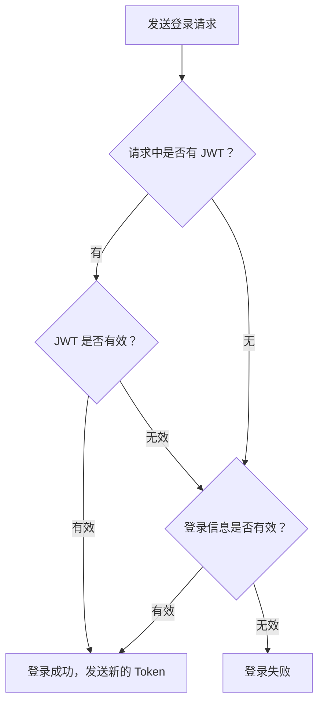

# T7

这道题显然是一道纯应用题，我们需要重视实现题中要求所需的业务逻辑。

## 大致思路

### 密码的加密

虽然题目中说是加密，其实指的应当是不可逆的散列。这个项目中我提供了`BCrypt`和`PBKDF2`两种加密方式。
要想达到根据场景不同切换加密方法的目的，我们需要一个`PasswordService`类，在其中提供密码的加密和验证相关操作；而在SpringBoot项目开发中，我们常用SpringSecurity提供的PasswordEncoder相关API进行操作。因此我们需要写出某种逻辑，使得passwordencoder能够自动切换加密方法类型。
要想实现两种方式的切换，需要在配置文件中修改：

```yml
spring:
  application:
    algorithm: "bcrypt"
```

只需修改这个字符串即可。


### 登录凭证

为了使登录更便捷，我们需要在服务端实现当用户进行登录时向客户端返回一个token(jwt)，以便于客户端保存并在之后的请求中使用。
要构建一个jwt，我们需要考虑其负载要填什么。对于本题，要填的东西大概如下：

- 用户名
- 令牌签发时间（最近一次登录时间）
- 令牌过期时间

暂时就这么多。
为什么没有密码？因为token中的内容并不是需要加密的内容，token设计的目的只是为了验证该用户已经登录过。这就像我可能在初次进入校园时需要提供身份证号，但一旦验证成功，发给我的校园的通行证不需要在上面写上这个隐私信息，而是用别的能确保身份唯一性（如学号）的参数标记。

### 登录流程图



## 代码

首先我们需要一个配置文件`Application.yml`：

```yml
spring:
  application:
    name: practice
    algorithm: "bcrypt"
    passwordMinLength: 8
    usernameregex: "^[a-zA-Z0-9]{3,}$"
  datasource:
    url: jdbc:mysql://localhost:3306/backend_t7
    username: ***
    password: ***
    driver-class-name: com.mysql.cj.jdbc.Driver
jwt:
  secret: "a3f1c9e7b52d8460f7e2a1c4d9b63850e4f7a2c1d8b5e69307f4a2c6d1e8b590"
  expirationtime: 60000
```

- 对于业务逻辑，我们设置了用户名格式、密码位数的区间；
- 对于加密，我们设置了加密算法；
- 对于登录凭证，我们设置了构建jwt用的密钥和token的有效期。

接着我们需要以下用于保存基本信息的类：

`User`类:

```java
package org.example.practice.entity;

public class User {
    private String username;
    private String password;

    public User() {
    }

    public User(String username, String password) {
        this.username = username;
        this.password = password;
    }

    public String getUsername() {
        return username;
    }

    public void setUsername(String username) {
        this.username = username;
    }

    public String getPassword() {
        return password;
    }

    public void setPassword(String password) {
        this.password = password;
    }
}

```

存储的内容暂时只有用户名和密码二者。（因为暂时没有做RBAC相关，暂时没有设role属性，望理解TAT）

`UserRequset`类：

```java
package org.example.practice.entity;

import jakarta.validation.constraints.NotBlank;

public class UserRequest {
    @NotBlank(message = "用户名不能为空")
    private String username;
    private String password;
    private String token;
    public String getUsername() {
        return username;
    }
    public void setUsername(String username) {
        this.username = username;
    }
    public String getPassword() {
        return password;
    }
    public void setPassword(String password) {
        this.password = password;
    }
    public String getToken() {
        return token;
    }
    public void setToken(String token) {
        this.token = token;
    }
}

```

比前者多了`Token`一个属性，并且加上了对用户名判空的注解。为什么用户名需要判空，之后在业务逻辑中会提到。

接下来我们需要`Mapper`接口：

```Java

package org.example.practice.mapper;

import org.example.practice.entity.User;
import org.apache.ibatis.annotations.Insert;
import org.apache.ibatis.annotations.Mapper;
import org.apache.ibatis.annotations.Select;

@Mapper
public interface UserMapper {

    @Insert("INSERT INTO user (username, password) VALUES (#{username}, #{password})")
    void insertUser(String username, String password);

    @Select("SELECT * FROM user WHERE username = #{username}")
    User findByUsername(String username);
}

```

暂时我们需要这两个方法，一个用来插入新的数据，一个用来查找。
与上一题一样，这里同样通过利用`#{}`避免了字符串的拼接，防止SQL注入攻击。

同时我们需要`Controller`：

```java
package org.example.practice.controller;

import jakarta.validation.Valid;
import org.example.practice.entity.UserRequest;
import org.example.practice.service.UserService;
import org.springframework.beans.factory.annotation.Autowired;
import org.springframework.web.bind.annotation.PostMapping;
import org.springframework.web.bind.annotation.RequestBody;
import org.springframework.web.bind.annotation.RestController;

import java.util.Map;

@RestController
public class UserController {
    @Autowired
    private final UserService userService;
    public UserController(UserService userService) {
        this.userService = userService;
    }

    @PostMapping("/register")
    public Map<String,String> register(@Valid @RequestBody UserRequest userRequest) throws Exception {
        return userService.register(userRequest);
    }
    @PostMapping("/login")
    public Map<String, String> login(@Valid @RequestBody UserRequest userRequest) throws Exception {
        return userService.login(userRequest);
    }
}

```

这里我们调用了service层的两个方法，对应两个接口，请求方法都是POST。在用`userRequest`接收数据时，同时检查参数是否有效。

```java

    @GetMapping("/getinfo")
    public User getinfo(@RequestParam String username) throws Exception{
        return userService.getinfo(username);
    }
```

这是获取用户信息的接口对应的方法，请求方法是GET。虽然目前没什么信息能给它返回的，但是之后如果要加信息，只需在User类中添加即可。

接着我们来到了Service层，这层中我们首先创建两个类分别来实现本体核心需要的两个难点：jwt和加密。

`PasswordService`类：

```java
package org.example.practice.service;

import org.springframework.beans.factory.annotation.Value;
import org.springframework.security.crypto.bcrypt.BCryptPasswordEncoder;
import org.springframework.security.crypto.password.Pbkdf2PasswordEncoder;
import org.springframework.stereotype.Service;
import org.springframework.security.crypto.password.PasswordEncoder;

import java.util.HashMap;
import java.util.Map;

@Service

public class PasswordService {
    private final PasswordEncoder passwordEncoder;

    public PasswordService(
            @Value("${spring.application.algorithm}") String algorithm) {
        Map<String, PasswordEncoder> encoders = new HashMap<>();

        encoders.put("bcrypt", new BCryptPasswordEncoder());
        encoders.put("pbkdf2", Pbkdf2PasswordEncoder.defaultsForSpringSecurity_v5_8());

        PasswordEncoder selected = encoders.get(algorithm);

        if (selected == null) {
            throw new IllegalArgumentException(
                    "不支持的密码算法: " + algorithm
            );
        }

        this.passwordEncoder = selected;
    }
    public String encode(String password) {
        return passwordEncoder.encode(password);
    }
    public boolean matches(String password, String encodedPassword) {
        return passwordEncoder.matches(password, encodedPassword);
    }
}

```

因为配置加密方法是在运行程序之前的，所以我们在构造方法中实现加密方法的选取。
我们写一个“仓库”`encoder`，用于提取出对应的解码器对象。Spring运行构造函数时自动给algorithm赋值，并由此找出对应的解码器。

`JWTService`类：

```java
package org.example.practice.service;

import io.jsonwebtoken.JwtBuilder;
import io.jsonwebtoken.Jwts;
import io.jsonwebtoken.security.Keys;
import org.springframework.stereotype.Service;

import org.springframework.beans.factory.annotation.Value;

import javax.crypto.SecretKey;
import java.nio.charset.StandardCharsets;
import java.util.Date;

@Service
public class JWTService {

    @Value("${jwt.secret}")
    private String secretKey;
    @Value("${jwt.expirationtime}")
    private int expirationTime;


    private SecretKey getSecretKey() {
        return Keys.hmacShaKeyFor(secretKey.getBytes(StandardCharsets.UTF_8));
    }
    public String generateToken(String username) {
        JwtBuilder builder = Jwts.builder();
        return builder.claim("username", username)
                .issuedAt(new Date())
                .expiration(new Date(System.currentTimeMillis() + expirationTime))
                .signWith(getSecretKey())
                .compact();
    }
    public boolean validateToken(String token) {
        try {
            Jwts.parser().verifyWith(getSecretKey()).build().parseSignedClaims(token);
            return true;
        } catch (Exception e) {
            return false;
        }
    }
    public String getUsername(String token) {
        return Jwts.parser().verifyWith(getSecretKey()).build().parseSignedClaims(token).getPayload().get("username",String.class);
    }
}

```

我们导入两个配置好的值，再将密钥字符串转换成jjwtAPI提供的类SecretKey对象。
生成新的token时，我们向payload加入的内容便是username、生产日期和失效日期。最后，用我们创建的密钥签名。
检查token是否有效，API为我们提供了比较简便的方法：在我们尝试用解析器把这个token解析成jws时，倘若检测到签名无效或者token已经过期，这个方法会自动报错。虽然两种情况报的错不一样，但是我们可以将其简化，都归为“token失效”。
获取用户名是我们稍后在userservice类中用到的功能。

在完成这两个基础的类之后，我们便开始用`userService`这个类实现业务逻辑：

```java
package org.example.practice.service;

import org.example.practice.entity.UserRequest;
import org.example.practice.mapper.UserMapper;
import org.springframework.beans.factory.annotation.Value;
import org.springframework.stereotype.Service;

import java.util.HashMap;
import java.util.Map;

@Service
public class UserService {
    private final JWTService jwtService;
    private final PasswordService passwordService;
    private final UserMapper userMapper;

    @Value("${spring.application.passwordMinLength}")
    private int passwordMinLength;
    @Value("${spring.application.usernameregex}")
    private String usernameregex;

    public UserService(JWTService jwtService, PasswordService passwordService, UserMapper userMapper) {
        this.jwtService = jwtService;
        this.passwordService = passwordService;
        this.userMapper = userMapper;
    }
    ...
}

```

首先我们需要三个对象，调用我们需要的方法；还需要两个变量存储我们配置的用户名和密码的格式。

```java

    public Map<String, String> register(UserRequest userRequest) throws Exception {
        if(userRequest.getPassword().length() < passwordMinLength) {
            throw new IllegalArgumentException("密码长度不能少于 " + passwordMinLength + " 个字符");
        }
        if(!userRequest.getUsername().matches(usernameregex)) {
            throw new IllegalArgumentException("用户名格式不正确");
        }
        if(userMapper.findByUsername(userRequest.getUsername()) != null){
            throw new IllegalArgumentException("用户名已存在");
        }
        userMapper.insertUser(userRequest.getUsername(), passwordService.encode(userRequest.getPassword()));
        return Map.of("message", "注册成功", "newToken", jwtService.generateToken(userRequest.getUsername()));
    }

```

这是用于注册的方法：我们需要避免的情况主要是用户名和密码格式上的问题，以及用户是否注册过的问题。
注意存入数据库中的密码是加密过的。
返回值是两条语句，提示语句和生成的token。

```java

    private Map<String , String> isLoginValid(UserRequest userRequest) throws Exception{
        if (userMapper.findByUsername(userRequest.getUsername()) == null) return Map.of("message", "用户名不存在");
        if(!passwordService.matches(userRequest.getPassword(), userMapper.findByUsername(userRequest.getUsername()).getPassword())) return Map.of("message", "密码错误");
        return Map.of("isLoginValid", "登录成功","newToken", jwtService.generateToken(userRequest.getUsername()));
    }

    public Map<String, String> login(UserRequest userRequest) throws Exception {
        Map<String, String> result = new HashMap<>();
        if(userRequest.getToken() != null) {
            if (!jwtService.validateToken(userRequest.getToken())) {
                result.put("howToken", "登录凭证签名无效或已过期");
                result.putAll(isLoginValid(userRequest));
                return result;
            }
            if (!jwtService.getUsername(userRequest.getToken()).equals(userRequest.getUsername())) {
                result.put("howToken", "登录凭证与用户名不匹配");
                return result;
            }
            if (userMapper.findByUsername(jwtService.getUsername(userRequest.getToken())) == null) {
                result.put("howToken", "登录凭证对应的用户不存在");
                result.putAll(isLoginValid(userRequest));
                return result;
            }
                return Map.of("message", "登录成功", "newToken", jwtService.generateToken(userRequest.getUsername()));
        }
        else {
            result.put("howToken","未检测到登录凭证");
            result.putAll(isLoginValid(userRequest));
            return result;
        }
    }
```

这是用于登录的方法。
对于有token的请求，我们要检查：

- token是否有效？
- token对应的用户名是否存在于与数据库中？
- token对应的用户名和传入的数据名相同？

最后一条是为了防止有请求用一个有效的token与一个其他的用户名进行登录，造成后续的异常或安全隐患。

检查完便说明token暂时是没问题的，放行便自动刷新即可。
如果上述检查中有问题，或没有传入token，则检测用户名和密码是否正确即可，这时就用到了`isLoginVaild`这个方法。通过调用mapper中的方法，检测用户名和密码是否正确，若错误则返回对应信息，若正确则返回对应信息和新的token。

由此可见，这个登录方法实现了为能够提供登录凭证或登录数据的人在每次访问接口时都自动赋予一个新的token，这就基本实现了token的刷新。

值得注意的是，这个方法返回的是若干条信息，由于消息数量不能确定（token是否生成不确定），因此要创建一个map用于存储并输出返回体。

```java
    public User getinfo(String username) throws Exception {
        if(username == null) throw new Exception("用户名为空");
        User user = userMapper.findByUsername(username);
        if(user == null) throw new Exception("用户不存在");
        return user;
    }
```

这是获取用户信息的方法。

最后我们也需要全局异常拦截器：

```java
package org.example.practice.handler;

import org.example.practice.service.UserService;
import org.springframework.http.converter.HttpMessageNotReadableException;
import org.springframework.web.bind.MethodArgumentNotValidException;
import org.springframework.web.bind.annotation.ExceptionHandler;
import org.springframework.web.bind.annotation.RestControllerAdvice;

import java.util.Map;

@RestControllerAdvice
public class GlobalExceptionHandler {

    @ExceptionHandler(MethodArgumentNotValidException.class)
    public Map<String, String> handleMethodArgumentNotValidException(MethodArgumentNotValidException e)
    {
        return Map.of("message", "参数校验失败");
    }
    @ExceptionHandler(HttpMessageNotReadableException.class)
    public Map<String, String> handleHttpMessageNotReadableException(HttpMessageNotReadableException e) {
        return Map.of("message", "请求JSON格式不正确");
    }
    @ExceptionHandler(IllegalArgumentException.class)
    public Map<String, String> handleIllegalArgumentException(IllegalArgumentException e) {
        return Map.of("message", e.getMessage());
    }

    @ExceptionHandler(Exception.class)
    public Map<String, String> handleException(Exception e) {
        return Map.of("message", e.getMessage() != null ? e.getMessage() : "未知异常");
    }
}

```

分别用于拦截请求参数错误、请求json格式、传入数据错误、其他错误。

## 思考

除了题目中的加分项“为用户加上权限”，还有什么可以优化的地方？

1. 异常处理后，返回的状态码全都是默认的200，可以通过引入API中的类来根据不同情况返回不同状态码。
2. 对于“未知异常”，并不能输出具体的报错语句，可能让开发者一头雾水。
3. `UserService`中反复调用同一个方法。
4. 密码加密环节，虽然我可以用不同的Encoder对密码进行加密，但是我不能用一个Encoder处理另一个Encoder生成的加密后的密码。
5. 还是直接把数据库的用户名密码写进了配置文件中，其实可以像上一道题一样引用另一条项目之外的路径来保证密码安全。
6. 处理token的逻辑链不太清楚，可能有其他未考虑到的情况。

因此，虽然这是我们的最后一道题，但做出来的项目仍然有待完善。如果时间允许，之后我会学习更多用于实战中的知识，用它来一步一步优化我的代码，实现更多、更能落地的项目。

## 测试


注册两个新用户

确认已经存入数据库

尝试重复注册，报错

不带token登录

带token登录并刷新

带无效token登录，信息错误，登录失败

带无效token登录，信息正确，登录成功

用alice的token登录bob的账号

不带用户名登录

查询用户信息

查询用户信息失败